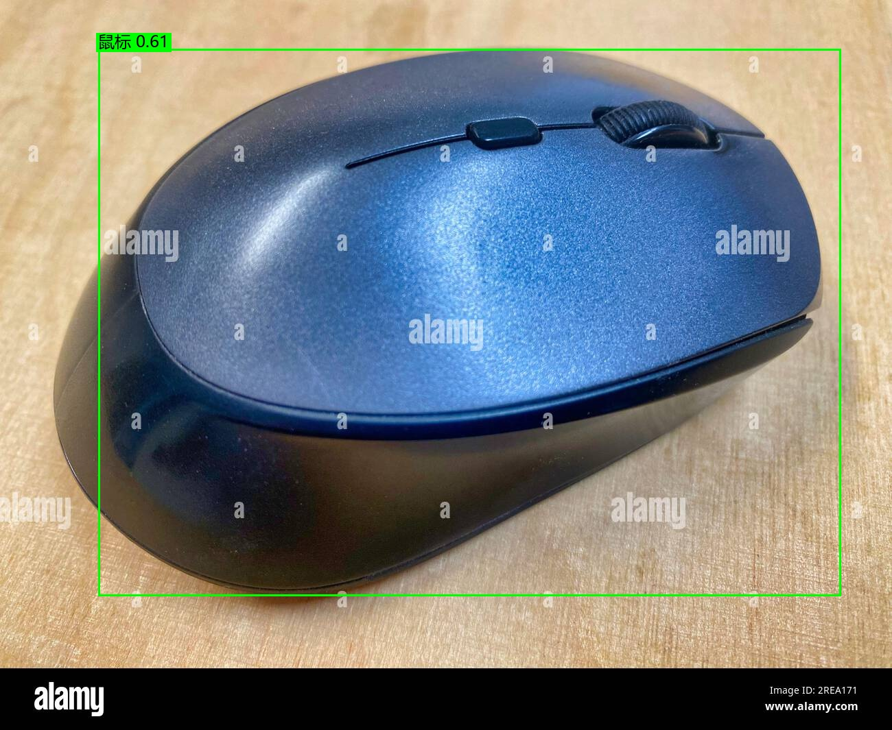
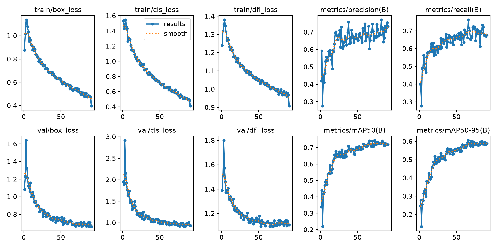
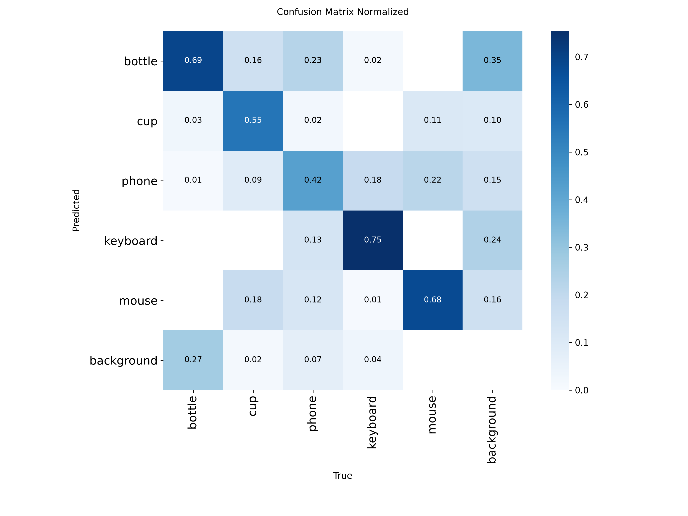

# YOLO 摄像头物体识别 —— 从零训练一个 5 类检测模型

用「网上爬图 + COCO 预训练模型自动打框」的方式，**当天**做出一个能在摄像头上实时识别
**水瓶 / 杯子 / 手机 / 键盘 / 鼠标** 的 YOLO 模型。整个流程全自动，**不需要手工标注一张图**。



## 快速开始（直接用训练好的模型）

```bash
git clone https://github.com/mantianxingdou10086/yolo-5class-camera.git
cd yolo-5class-camera
py -m pip install ultralytics opencv-python pillow numpy

py 05_摄像头识别.py            # 打开摄像头实时识别，按 q 退出
```

仓库里**已经带了训练好的权重**（`runs/5class_v2/weights/best.pt`，19MB），clone 下来装完依赖
就能直接跑，不需要 GPU、不需要数据集。

想让模型认得别的物体，或者想自己重跑一遍全流程：

```bash
py 01_爬图.py                 # 1. 爬图（约 20 分钟，1850 张）
py 02_清洗并划分数据集.py      # 2. 清洗去重 + 按 9:1 分 train/val
py 03_自动标注.py              # 3. 用 COCO 预训练的 YOLO11x 自动打框（要 GPU，约 4 分钟）
py 04_训练.py                  # 4. 训练（约 27 分钟）
py 05_摄像头识别.py            # 5. 开摄像头实测
py 06_看结果.py                # （可选）算每类精度 + 生成带中文框的预览图
```

## 仓库里有什么 / 没有什么

| | 内容 | 说明 |
|---|---|---|
| ✅ 有 | 10 个流程脚本 | 爬图 → 清洗 → 自动标注 → 训练 → 实测 → 评估，全部可跑 |
| ✅ 有 | 训练好的权重 ×2 | `runs/5class/weights/best.pt`（v1）、`runs/5class_v2/weights/best.pt`（v2，默认用这个） |
| ✅ 有 | 训练曲线与实测预览图 | `runs/*/` 下的 PR/F1 曲线、混淆矩阵、带中文框的预览图 |
| ❌ 无 | 数据集图片（711MB） | 爬来的原图 + 清洗后的训练/测试集。跑 `01`~`03` 就能重新生成 |
| ❌ 无 | 预训练权重 `weights/*.pt` | `yolo11x.pt` 单个 114MB，超过 GitHub 100MB 文件上限。下载方式见下 |

**要重跑训练时先补两个预训练权重**（`weights/` 目录被 gitignore 了）：

```bash
mkdir -p weights
# 教师模型：自动标注用（越大越好）
curl -L --http1.1 -o weights/yolo11x.pt https://hf-mirror.com/Ultralytics/YOLO11/resolve/main/yolo11x.pt
# 学生模型：从它开始微调
curl -L --http1.1 -o weights/yolo11s.pt https://hf-mirror.com/Ultralytics/YOLO11/resolve/main/yolo11s.pt
```

## 目录结构

```
yolo识别物体/
├── 01_爬图.py               # 从必应图片搜索批量下载 5 类图片（64 线程并发）
├── 01_补爬.py               # 给样本偏少的类补爬（键盘/鼠标）
├── 02_清洗并划分数据集.py    # 去重、剔除坏图，按 9:1 分 train/val，写 data.yaml
├── 03_自动标注.py           # 用 YOLO11x 自动打框生成标签
├── 04_训练.py               # 第一轮训练（yolo11s）
├── 05_摄像头识别.py         # 摄像头实时识别（中文标签，按 q 退出）
├── 06_看结果.py             # 每类精度 + 预览图
├── 07_训练v2.py             # 第二轮训练（更多数据 + 更干净标签）
├── 08_做测试集.py           # 爬一批全新图片做"外部测试集"（公平评估用）
├── 09_对比评估.py           # 在同一外部测试集上对比多个模型
├── dataset/                 # 【不进库】跑 01~03 生成
│   ├── raw/<类别>/          # 爬来的原图（2050 张）
│   ├── images/train|val/    # 清洗划分后的图
│   ├── labels/train|val/    # 自动标注的标签（YOLO txt 格式）
│   ├── test/                # 外部测试集（294 张，两个模型都没见过）
│   └── data.yaml            # 训练配置
├── weights/                 # 【不进库】预训练权重（yolo11s / yolo11x / yolo26n）
└── runs/
    ├── 5class/weights/best.pt      # v1 模型
    └── 5class_v2/weights/best.pt   # v2 模型（默认用这个）
```

## 关键原理

**为什么能"不标注"就训练？**
COCO 数据集里本来就有 bottle / cup / cell phone / keyboard / mouse 这 5 类。
拿 COCO 上训练好的 YOLO11x 跑一遍爬来的图，把命中这 5 类的检测框写下来，
就得到一批"伪标注"。虽然不如人工标注干净，但对这几个常见类别质量够用。
（代价：教师模型的毛病也会被学生学去，所以我们做了同类重复框清理。）

**为什么从预训练权重开始训？**
`yolo11s.pt` 已经在 COCO 上见过大量图像，学到的边缘/纹理/形状特征可以直接用，
只需在自有小数据集上微调，一千多张图 × 100 轮就能收敛得不错（mAP50 ≈ 0.74）。

## 实测结果

### 各自验证集上的表现（诚实但不可直接互比：验证集不同）

| 版本 | 数据 | 轮数 | mAP50 | mAP50-95 |
|---|---|---|---|---|
| v1 | 1850 张原图 | 94（第 69 轮最佳） | 0.782 | 0.654 |
| v2 | 补爬键盘/鼠标 +200 张 | 91（第 66 轮最佳） | 0.741 | 0.605 |

### 公平对比：同一个外部测试集（294 张全新图片 / 979 个目标）

这份测试集的图两个模型都没见过，标签由同一个教师模型统一生成：

| 模型 | mAP50 | mAP50-95 | 水瓶 | 杯子 | 手机 | 键盘 | 鼠标 |
|---|---|---|---|---|---|---|---|
| v1 | **0.724** | 0.609 | 0.518 | **0.852** | 0.681 | **0.768** | 0.801 |
| v2 | 0.722 | **0.623** | **0.524** | 0.814 | **0.686** | 0.747 | **0.838** |

**结论：两版基本打平。** v1 的 mAP50 略高（0.724 vs 0.722），v2 的 mAP50-95 更好
（框更贴合，0.623 vs 0.609）且鼠标类明显更准。**默认交付 v2**（05/06 脚本默认用它，
也可以 `py 05_摄像头识别.py runs/5class/weights/best.pt` 切回 v1）。





### 摄像头实测

`05_摄像头识别.py` 在 640×480 摄像头下开箱可用，连续取帧 10/10 成功，
实时画面能正确输出类别 + 置信度，中文标签正常显示。

更多带中文框的实际识别效果（12 张）：`runs/5class_v2/预览图/`

### 短板

- **水瓶在外部测试集上最弱（0.52）**：训练集里的水瓶多是商品图/特写，测试集里有货架、
  手持等场景，存在域差异。想提升就针对这些场景多爬图。
- **键盘最容易被框出重复框**：教师模型会把键盘局部也当成键盘，已在 v2 标注时做同类
  重叠框清理，但重叠度低于阈值时仍会漏网。

## 本机环境与踩过的坑

| 问题 | 现象 | 解决 |
|---|---|---|
| torch 是 CPU 版 | `torch.cuda.is_available()` 为 False，GPU 用不上 | 装 CUDA 版：`pip install --index-url https://download.pytorch.org/whl/cu130 torch torchvision`（RTX 5060 是 sm_120，要 cu128 以上） |
| 走 HTTP/2 会卡死 | curl 返回 200 但一个字节都收不到 | curl 一律加 `--http1.1` |
| GitHub 直连不通 | 下不了官方预训练权重 | 用 `https://ghfast.top/https://github.com/...` 或 `https://hf-mirror.com/Ultralytics/YOLO11/resolve/main/...` |
| pip 下载会卡死 | 卡在下载不动 | 用 curl 手动下 .whl 再 `pip install 本地文件`；文件名必须是标准轮子名 |
| 单连接下载慢 | torch 轮子 2GB 要 2 小时 | 分块并行下载（8 条连接各拉 100MB 再拼接） |
| 爬图慢 | 8 线程只有 0.8 张/秒 | 图床响应慢，靠线程堆吞吐：64 线程约 8 张/秒 |
| 深页链接质量差 | 翻到后面几页全是垃圾外链 | 多给关键词、少翻页（每个关键词只翻 5 页） |
| AMP 自检要联网 | 训练开始时去下 yolo26n.pt，断网就报错 | 预先放好 `weights/yolo26n.pt`，或让脚本自动关掉 AMP |
| 中文变量名 | bash 报 `每个块=64: command not found` | bash 脚本里变量名必须用英文 |
| 日志里的中文路径 | 训练日志显示 `D:\yolo\...` | 只是 ultralytics 打日志时的路径处理问题，权重其实正常落在项目目录 |
| 摄像头显示中文乱码 | OpenCV 的 putText 不支持中文 | 用 PIL + `C:/Windows/Fonts/msyh.ttc` 画字 |

## 想继续变强的方向

1. **补域差异数据**：针对货架、手持、不同光照的水瓶/杯子多爬图。
2. **人工修一遍标签**：伪标注难免有错，用 labelImg 之类工具修几十张最难的，效果提升明显。
3. **换更大的模型**：`weights/yolo11x.pt` 已下好，改 `04_训练.py` 里的预训练权重即可，精度更高但慢一些。
4. **加负样本**：故意混入一批"没有目标"的图，能压掉误检。
5. **训练尺寸调大**：`imgsz=960` 对小目标（手机）更友好，显存 8G 够用。

## 说明

- 数据集图片来自必应图片搜索的公开结果，仅用于教学演示与内部培训，版权归原作者所有；
  仓库本身不包含这些图片，只提供爬取脚本。
- 环境：Windows 11 + Python 3.13 + ultralytics 8.4 + RTX 5060 Laptop (8G)。
- 编写人：满天星斗烟火繁（HITCRT 视觉组）
